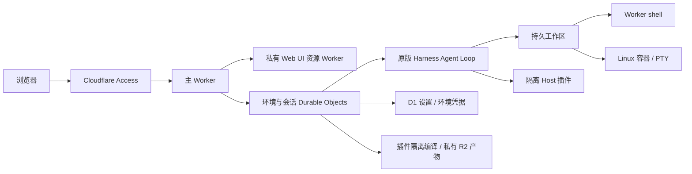

# Weft

**把 DeepSeek Harness 运行在 Cloudflare 上。**

Weft 将原版 Agent Loop、Web UI 与 Cordis 插件体系接入 Cloudflare Workers、Durable Objects 和 Linux 容器，让你通过浏览器使用拥有持久会话、独立工作区和真实终端的 AI 编程助手。

你可以部署到自己的 Cloudflare 账号，使用自己的模型 API Key，并通过 Cloudflare Access 控制访问。多个用户共用一套部署时，各自拥有独立的环境、会话和工作区。

> Weft is an independent Cloudflare adaptation of [DeepSeek Harness](https://github.com/deepseek-ai/deepseek-harness), with persistent sessions, isolated agent environments, Linux terminals and native Cordis bundles.

## 为什么做 Weft

DeepSeek Harness 提供了 Agent 的执行逻辑、交互界面和插件生态。Weft 负责把这些能力接入云端运行环境：身份认证、持久存储、工作区文件、容器进程，以及插件的构建与授权。

项目优先复用原版服务和界面，平台适配集中在本仓库中。上游版本由 [`upstream.lock.json`](upstream.lock.json) 固定，构建时获取并校验；不需要手动修改上游源码。

Weft 适合希望自行托管 Web 编程助手、通过浏览器访问远程工作区，或在同一部署中维护多个独立 Agent 环境的开发者。

## 能做什么

| 能力 | 说明 |
| --- | --- |
| 浏览器工作台 | 复用原版 Web UI，处理对话、文件、终端、设置与插件 |
| 独立 Agent 环境 | 每套环境分别保存模型配置、凭据、插件、会话和工作区 |
| 持久会话 | 保存对话与执行记录，支持历史、搜索、排队、取消和恢复 |
| 多模型接入 | 通过原版 Models 设置配置 DeepSeek、OpenAI、Anthropic 等提供商 |
| 原版 Agent 能力 | 标准、PTC、极简与创造预设，以及命令、Plan、Goal、Skills 和子 Agent 等服务 |
| Linux 工作区 | 在容器中使用 git、Node.js、Python、真实进程与 PTY 交互终端 |
| 文件与附件 | 读写和搜索工作区，上传文件、处理图片并查看会话附件 |
| Cordis 插件 | 从 npm 安装原版 bundle，或在创造模式下由 Agent 编写插件，审核后加载 |
| 用户隔离 | 使用 Cloudflare Access 身份，将数据与运行权限限定在所属用户和环境 |

## 命令在哪里运行

工作区支持两种后端，环境设置提供三种选择：

| 模式 | 行为 | 适用场景 |
| --- | --- | --- |
| 自动 | 从 Worker shell 开始，Agent 在任务需要时切换到容器 | 日常使用，按任务选择运行环境 |
| 仅 Worker | 使用轻量 shell，不启动 Linux 容器 | 文件处理与 Worker shell 已支持的命令 |
| 始终容器 | 命令和终端使用真实 Linux 进程 / PTY | Git 项目、依赖安装、构建与交互程序 |

Worker shell 没有 git、Node.js 或 Python。容器需要启动时间，空闲后会休眠；下一次容器命令可重新启动。运行位置可以在 **Plugins → 工作区运行环境** 中配置。

源码和 `.git` 持久保存。容器内的 `node_modules`、`.venv` 和常见缓存保存在容器本地，容器替换后需要按锁文件重建。

## 架构概览



- **Workers** 处理请求、认证和平台接入，原版界面由私有资源 Worker 提供。
- **Durable Objects** 持有环境与会话的运行上下文，使用 SQLite 保存会话和工作区状态。
- **Containers** 执行 Linux 命令、进程与终端；插件编译使用单独的容器。
- **Dynamic Worker facets** 执行 Host 插件，通过授权的桥接服务访问工作区。

模型凭据由用户保存在所属环境中，应用不提供平台共享密钥回退。

## 快速开始

需要 **Node.js 22.19+、npm 和 Git**。进入项目目录后运行：

```bash
npm ci
npm run dev
```

首次构建会下载固定版本的上游源码。打开 `http://127.0.0.1:8787`，创建或选择 Agent 环境，再到 **Settings → Models** 填写模型 API Key、模型和 HTTPS endpoint，即可开始对话。

本地开发使用模拟身份，仅监听回环地址；会自动初始化 D1 表结构，数据保存在 `.cloudflare/local-state/`。无需维护者账号或生产部署配置，也不需要将模型密钥写进 `.env`。

本地可使用 Worker shell、会话、设置与动态 Worker 插件。真实 Linux 容器及 npm 插件隔离编译服务需要云端部署。

## 部署到自己的账号

云端部署需要自己的域名，以及启用了所需服务的 Cloudflare 账号。项目使用 Workers、Durable Objects、D1、私有 R2、Worker Loader、Images、Containers 和 Access。

部署流程：

1. 创建 Access 应用、D1 数据库和私有 R2 bucket，应用数据库迁移。
2. 将 [`deployment.example.json`](deployment.example.json) 复制到 `.weft/deployment.json`，填写自己的资源配置。
3. 在 GitHub Actions 中验证并导出容器镜像，发布到自己的 Cloudflare 镜像仓库。
4. 使用完整部署配置构建，再依次发布私有 UI Worker 与主 Worker。

私有配置也可通过 `WEFT_DEPLOY_CONFIG` JSON 构建变量提供。`.weft/` 已被 Git 忽略；源码不绑定维护者的 Cloudflare 账号或域名。

具体命令、配置字段、镜像发布及自动部署步骤见 **[部署指南](docs/deployment.md)**。

## 插件如何工作

插件使用原版 `package.json.dsh.bundle.patch` 声明与标准 Cordis 导出：

```json
{
  "name": "my-dsh-plugin",
  "version": "1.0.0",
  "main": "./index.js",
  "dsh": {
    "bundle": {
      "patch": "./cordis.patch.yml"
    }
  }
}
```

通过原版 **Plugins → 添加插件** 安装公开 npm 包。安装器锁定版本和依赖、校验归档并隔离编译；构建后保持停用，由用户在包详情页检查 patch、代码、摘要和所需能力，批准后启用。

创造模式还允许 Agent 编写双端 Cordis 插件，同样需要用户审核运行版本。Host 在隔离环境中执行；Client 在工作台页面执行，批准前需要确认代码来源与行为。

当前支持的宿主服务、包来源与格式边界见 **[原版插件安装](docs/validation/package-installation.md)**；已适配的官方组合包见 **[官方组合包](docs/validation/official-bundles.md)**。

## 与本地 DSH 的差异

Weft 保留原版交互与插件声明，但运行能力取决于 Cloudflare 宿主和已实现的服务桥接。

- **文件大小**：同步工作区的单文件上限为 256 MiB，大型 Git pack 可能超限。按任务选择浅克隆或稀疏检出，详见[Git 工作区说明](docs/architecture/workspace-git.md)。
- **进程状态**：容器重启后不恢复已有进程、PTY 或终端内存状态，命令不会自动重放。
- **本地依赖**：容器缓存不属于持久文件卷，Worker 和文件侧栏看不到这些本地依赖文件。
- **插件兼容性**：依赖 Node 内置模块、原生扩展或未桥接服务的插件可能无法运行；不支持的能力会明确拒绝。
- **待适配能力**：端口预览、Office 转 PDF、平台账号登录及更多本地宿主服务尚未完整接入。

## 开发与贡献

欢迎提交问题和 Pull Request。开发约定、上游适配方式及验证流程见 [CONTRIBUTING.md](CONTRIBUTING.md)；安全问题请参阅 [SECURITY.md](SECURITY.md)。

测试工作流在 Pull Request、`ci` 分支和手动触发时运行，覆盖构建、类型检查、workerd、浏览器、离线插件编译，以及真实容器进程 / PTY / Git / FUSE。常规 CI 不需要模型密钥；真实模型联调需显式启用。

| 目录 | 内容 |
| --- | --- |
| `apps/worker` | Worker 入口、HTTP 与 Durable Object 接线 |
| `apps/web`、`apps/assets` | Web 入口、原版界面扩展与私有静态资源 |
| `apps/workspace-container` | Linux 进程、PTY 与工作区同步 |
| `apps/plugin-builder` | 插件隔离编译容器 |
| `packages` | Harness 与 Cloudflare 平台适配模块 |
| `migrations` | D1 版本迁移 |
| `scripts`、`tests` | 上游准备、构建发布与行为回归 |

## 更多文档

- [部署指南](docs/deployment.md)
- [多环境与官方 UI](docs/architecture/agent-environments.md)
- [真实进程与 PTY](docs/architecture/workspace-processes.md)
- [Git 项目与工作区](docs/architecture/workspace-git.md)
- [原版插件安装](docs/validation/package-installation.md)

`docs/validation/` 记录各项能力的实现与历史验证过程；当前使用方式以本 README 和部署指南为准。

## 许可与致谢

Weft 采用 [MIT License](LICENSE)。感谢 [DeepSeek Harness](https://github.com/deepseek-ai/deepseek-harness) 和 Cloudflare 的开源项目。

上游源码与依赖保留各自的版权和许可，见 [THIRD_PARTY_NOTICES.md](THIRD_PARTY_NOTICES.md)。构建产物也包含第三方许可清单 `/licenses.txt`。
