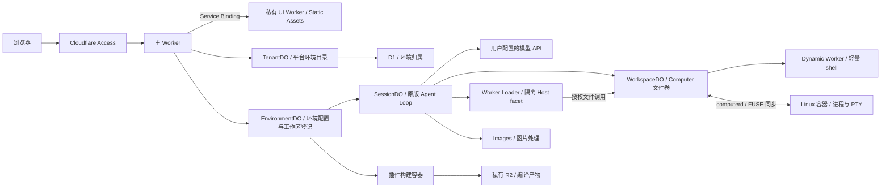

# Weft

**把 DeepSeek Harness 运行在 Cloudflare 上。**

Weft 将原版 Agent Loop、Web UI 与 Cordis 插件体系接入 Cloudflare Workers、Durable Objects 和 Linux 容器，让你通过浏览器使用拥有持久会话、独立工作区和真实终端的 AI 编程助手。

你可以部署到自己的 Cloudflare 账号，使用自己的模型 API Key，并通过 Cloudflare Access 控制访问。多个用户共用一套部署时，各自拥有独立的环境、会话和工作区。

> Weft is an independent Cloudflare adaptation of [DeepSeek Harness](https://github.com/deepseek-ai/deepseek-harness), with persistent sessions, isolated agent environments, Linux terminals and native Cordis bundles.

## 为什么做 Weft

DeepSeek Harness 提供了 Agent 的执行逻辑、交互界面和插件生态。Weft 负责把这些能力接入云端运行环境：身份认证、持久存储、工作区文件、容器进程，以及插件的构建与授权。

项目优先复用原版服务和界面，平台适配集中在本仓库中。当前适配 **DSH `0.2.1-rc.3`**，由 [`upstream.lock.json`](upstream.lock.json) 固定提交，构建时获取并校验；不需要手动修改上游源码。原版前端、Remote ABI、插件与运行时从同一份源码构建，升级边界见[兼容性说明](docs/architecture/upstream-compatibility.md)。

Weft 适合希望自行托管 Web 编程助手、通过浏览器访问远程工作区，或在同一部署中维护多个独立 Agent 环境的开发者。

## 能做什么

| 能力 | 说明 |
| --- | --- |
| 浏览器工作台 | 复用原版 Web UI，处理对话、文件、终端、设置与插件 |
| 独立 Agent 环境 | 每套环境分别保存模型配置、凭据、插件、会话和工作区 |
| 环境管理 | 首页提供重命名、暂停／恢复与确认删除；暂停保留数据，删除清理所属存储与运行资源 |
| 环境复制 | 复制配置和持久工作区文件，支持进度与失败续传；会话、受管凭据和运行状态不继承 |
| 持久会话 | 保存对话与执行记录，支持历史、搜索、排队、取消和恢复 |
| 多模型接入 | 通过原版 Models 设置配置 DeepSeek、OpenAI、Anthropic 等提供商 |
| 原版 Agent 能力 | 标准、PTC、极简与创造预设，以及命令、Plan、Goal、Skills 和子 Agent 等服务 |
| Linux 工作区 | 在容器中使用 git、Node.js、Python、真实进程与 PTY 交互终端 |
| 文件与附件 | 读写和搜索工作区，上传文件、处理图片并查看会话附件 |
| Worker 数据与文档处理 | 可恢复的 JavaScript 任务、原版审批流程，以及通过 Cloudflare Workers AI 将 Office、PDF、图片等内容提取为 Markdown |
| Cordis 插件 | 从 npm 安装原版 bundle，或在创造模式下由 Agent 编写插件，审核后加载 |
| 用户隔离 | 使用 Cloudflare Access 身份，将数据与运行权限限定在所属用户和环境 |
| 本地 DSH 环境 | 安装原生 Host 连接插件，通过出站连接在 Web 使用本机的会话、插件、文件与终端；支持 DSH `0.2.1-rc.2`、`0.2.1-rc.3` |

本地模式从首页「连接本地 DSH」开始，下载连接配置和原生 `dsh.bundle.patch` 插件包。
本机运行原版 `dsh web`，网页加载该 Host 自己的工作台与客户端插件；Weft 负责身份、环境登记和中继。
部署者需先配置设备端点的 Access 路由，详见[本地环境接入](docs/deployment/local-host.md)。

## 如何把本地环境搬到 Cloudflare

本地 DSH 的服务依赖宿主进程、磁盘、配置文件、系统工具和桌面身份。Weft 按原版 Harness / Cordis 的服务接口替换这些依赖：Agent Loop 与 UI 继续使用原版实现，存储、执行和身份认证交给对应的 Cloudflare 组件。

### 本地依赖与云端组件的对应关系

| 本地依赖 | Cloudflare 组件 | Weft 如何接入 |
| --- | --- | --- |
| 本地 HTTP 服务与 API 入口 | Workers | 主 Worker 验证身份、处理 HTTP / SSE / WebSocket，并把请求转到所属环境和会话 |
| 本地 Web 静态文件服务 | [Workers Static Assets](https://developers.cloudflare.com/workers/static-assets/) + Service Binding | 原版 UI 构建为静态资源，由私有 UI Worker 提供；浏览器经主 Worker 认证后访问 |
| 宿主进程中的 Agent 与服务实例 | [Durable Objects](https://developers.cloudflare.com/durable-objects/) | 环境和会话各有自己的对象，装配原版服务、协调状态和并发操作 |
| 配置文件、预设版本、会话 JSONL、插件状态与本地凭据存储 | DO SQLite | 环境配置与工作区登记保存在 EnvironmentDO，会话事件保存在 SessionDO；使用原版 schema、协议与持久化适配器，凭据只通过所属环境的服务解析 |
| 用户所属的环境目录 | [D1](https://developers.cloudflare.com/d1/) | `CONFIG_DB` 只保存平台环境目录与租户归属；环境内部的设置、预设版本和工作区登记由 EnvironmentDO 自己持有 |
| 工作区磁盘与文件系统 API | DO SQLite + `@cloudflare/computer` | WorkspaceDO 保存虚拟文件系统；原版文件工具通过 FileSystem 适配器读写，容器通过 computerd / FUSE 使用同一文件卷 |
| bash、git、Node.js、Python 与 PTY | [Cloudflare Containers](https://developers.cloudflare.com/containers/) | Linux 容器提供真实进程与终端，WorkspaceDO 协调文件同步，独立的容器宿主 DO 管理实例生命周期 |
| 运行时生成代码与外部 Host 插件执行 | [Dynamic Workers](https://developers.cloudflare.com/dynamic-workers/) / Worker Loader | 按需加载代码；外部 Host 插件在隔离 DO facet 中执行，通过受限桥接调用已授权服务 |
| npm 插件本地编译与产物目录 | 独立构建容器 + [私有 R2](https://developers.cloudflare.com/r2/) | 下载并锁定包与依赖后离线编译；R2 保存不可变产物，EnvironmentDO 保存安装、审批和启停记录 |
| 本地图片解码、缩放与编码库 | [Cloudflare Images binding](https://developers.cloudflare.com/images/optimization/binding/) | 读取真实图片信息，生成满足模型尺寸与字节预算的版本；图片文件保存在工作区存储中 |
| Office 文档提取 CLI | [Workers AI Markdown Conversion](https://developers.cloudflare.com/workers-ai/features/markdown-conversion/) | Worker 读取原始文件并调用 `AI.toMarkdown`，可将结果保存为新的 `.md` 文件；PPTX 文字先在 Worker 中提取 |
| 常驻进程中的提醒计时器 | Durable Object Alarms | 保存原版 Schedule 任务，并以最近到期时间设置 Alarm，唤醒会话服务交付提醒 |
| 本机用户与 Web 登录入口 | [Cloudflare Access](https://developers.cloudflare.com/cloudflare-one/access-controls/applications/choose-application-type/) | Access 执行访问策略，主 Worker 校验身份并派生租户，再按环境和会话校验访问范围 |

这些替换集中在本仓库的适配层。原版工具仍调用 FileSystem、Subprocess、SessionPersistence 等接口；Weft 将这些调用转到云端存储或容器，保留原版的工具协议、配置校验和组件生命周期。

Worker 的 `nodejs_compat` 提供部分 Node API 兼容能力，运行约束仍由 Workers 决定。依赖系统进程的工作负载放进容器，需要宿主服务的插件通过适配与授权接入；插件兼容范围见[原版插件安装](docs/validation/package-installation.md)。

### 请求和数据如何流动



以“修改项目并运行构建”为例：

1. 用户通过 Access 登录，主 Worker 将提示词路由到所属环境的 SessionDO。
2. SessionDO 装配原版 Agent 服务，从持久记录读取会话、配置与预设，再调用用户配置的模型 API。
3. 模型调用文件工具时，FileSystem 适配器访问 WorkspaceDO，更新持久文件内容和版本。
4. 需要 `npm install` 或构建时，命令在 Linux 容器中执行。容器挂载同一工作区，运行期间及确认进程退出前同步文件变更。
5. 工具结果和会话事件按原版协议保存并流式返回页面。容器关闭后，后续启动可重新挂载源码；已有进程和终端状态不会恢复。

### 状态保存在哪里

| 存储位置 | 当前保存的数据 | 生命周期 |
| --- | --- | --- |
| D1 | 平台环境目录、显示名称与租户归属 | 由 TenantDO 管理；预留用户、成员权限与配额等平台抽象 |
| SessionDO SQLite | 会话头、事件日志、原版服务状态、动态插件定义和运行记录 | 对象重建后从持久记录恢复 |
| EnvironmentDO SQLite | 环境设置、Agent 预设版本、工作区登记与会话归属、凭据、会话索引、插件安装与审批记录 | 由所属环境持有；环境内部操作不访问 D1 |
| WorkspaceDO SQLite / Computer | 源码、`.git`、工作区文件、附件及图片衍生版本 | 独立于 Linux 容器；文件内容与版本由工作区服务管理 |
| 私有 R2 | 已构建 npm 插件包的不可变代码与审核产物 | 按安装记录和产物摘要读取 |
| 容器本地磁盘 | `node_modules`、`.venv`、常见缓存与临时文件 | 容器替换后需要重建 |

D1 管理环境之外的平台目录；DO SQLite 让配置、业务状态与拥有它的环境或会话放在一起；R2 承载编译产物。设置表单和工作区登记使用真实原版 SettingsForms、WorkspaceRegistry 与 StorageDomain；整份配置 YAML 原子提交，会话列表使用可重建摘要。当前项目的持久工作区使用 Computer 的 DO 存储后端，源码和 `.git` 保存在 WorkspaceDO 中。

DO 的内存实例也可能重建。Weft 持久保存的是会话、配置和服务记录；正在执行的 Linux 进程、PTY 与普通 JavaScript 内存变量不属于这些持久记录。

当前采用 `harness-v2` 数据布局，不导入旧环境配置、会话、文件卷或浏览器缓存。更新已有部署会得到全新的环境内部状态，平台环境目录继续保留；迁移 `0007` 删除旧 D1 环境内部表。详见[数据归属与重置](docs/architecture/environment-storage.md)。

### 用户、环境、工作区和会话

Access 身份对应用户租户；每个租户可创建多个环境。环境拥有独立的配置、凭据、插件、会话索引和文件卷。官方 Web 接入中，同一环境的项目目录与会话共享默认文件卷和所选规格的工作区容器。

工作区记录指定项目路径，会话以该路径作为 `cwd`。子目录用于组织项目与会话；同一环境中的目录共享访问范围，需要独立配置和运行资源时应创建不同环境。不同浏览器会话也不各自分配一台长期在线的机器。

在工作区菜单选择 **添加工作区**，可用原版目录弹窗浏览 `/workspace` 下的已有目录、新建文件夹，或输入完整路径。添加后在该工作区创建的会话以所选目录开始，文件侧栏和终端使用该会话的目录；刷新后保留工作区与会话归属。移除工作区条目会保留实际文件和会话记录。

## 命令在哪里运行

工作区支持两种执行后端，环境设置提供三种选择：

| 模式 | 行为 | 适用场景 |
| --- | --- | --- |
| 自动 | 从 Worker shell 开始，Agent 在任务需要时切换到容器 | 日常使用，按任务选择运行环境 |
| 仅 Worker | 使用轻量 shell，不启动 Linux 容器 | 文件处理与 Worker shell 已支持的命令 |
| 始终容器 | 命令和终端使用真实 Linux 进程 / PTY | Git 项目、依赖安装、构建与交互程序 |

Worker shell 在 Dynamic Worker 中解释支持的命令，文件操作回到 WorkspaceDO；它没有 git、Node.js 或 Python。Linux 容器负责系统工具、依赖安装和交互进程，镜像内包含对应运行时。

在 **Plugins → 工作区运行环境** 中选择执行模式和容器规格。容器按需启动，空闲 10 分钟后休眠；源码和 `.git` 持久保存，容器本地依赖与缓存需要在替换实例后按锁文件重建。计算实例的休眠与工作区数据的保留分别管理。

模型推理由用户配置的提供商 API 完成，凭据在所属环境的 **Settings → Models** 中保存。Cloudflare Images 负责图片处理，Workers AI 的 `AI` binding 用于文档转 Markdown。可恢复 JavaScript 任务通过 `javascript_task` 使用，Code Mode 也可调用；任务恢复、审批和文档格式边界见[Worker 任务与文档提取](docs/architecture/worker-tasks-and-documents.md)。

## 快速开始

需要 **Node.js 22.19+、npm 和 Git**。进入项目目录后运行：

```bash
npm ci
npm run dev
```

首次构建会下载固定版本的上游源码。打开 `http://127.0.0.1:8787`，创建或选择 Agent 环境，再到 **Settings → Models** 填写模型 API Key、模型和 HTTPS endpoint，即可开始对话。

首页显示当前登录邮箱；创建环境时可展开 YAML 高级配置，使用与设置页一致的 `profile.yml` 条目格式。配置通过校验后才会创建环境。卡片的「更多操作」提供重命名、暂停／恢复和删除；暂停停止智能体、终端与后台任务，恢复后终端命令需重新运行。删除需要输入环境名称确认，默认环境可暂停与重命名但不可删除。操作进度在刷新后继续显示，失败可重试。详见[环境生命周期](docs/architecture/environment-lifecycle.md)。

本地开发使用模拟身份，仅监听回环地址；会自动初始化 D1 表结构，数据保存在 `.cloudflare/local-state/`。无需维护者账号或生产部署配置，也不需要将模型密钥写进 `.env`。

本地可使用 Worker shell、会话、设置与动态 Worker 插件。真实 Linux 容器及 npm 插件隔离编译服务需要云端部署。

## 部署到自己的账号

云端部署需要自己的域名，以及启用了所需服务的 Cloudflare 账号。项目使用 Workers、Durable Objects、D1、私有 R2、Worker Loader、Images、Containers 和 Access。

部署流程：

1. 创建 Access 应用、D1 数据库和私有 R2 bucket，应用数据库迁移。
2. 将 [`deployment.example.json`](deployment.example.json) 复制到 `.weft/deployment.json`，填写自己的资源配置。
3. 在 GitHub Actions 中验证并导出容器镜像，发布到自己的 Cloudflare 镜像仓库。
4. 使用完整部署配置构建，再依次发布私有 UI Worker 与主 Worker。

私有配置也可通过 `WEFT_DEPLOY_CONFIG` JSON 构建变量提供。`.weft/` 已被 Git 忽略；源码不绑定维护者的 Cloudflare 账号或域名。

具体命令、配置字段、镜像发布及自动部署步骤见 **[部署指南](docs/deployment.md)**。

## 插件如何工作

插件使用原版 `package.json.dsh.bundle.patch` 声明与标准 Cordis 导出：

```json
{
  "name": "my-dsh-plugin",
  "version": "1.0.0",
  "main": "./index.js",
  "dsh": {
    "bundle": {
      "patch": "./cordis.patch.yml"
    }
  }
}
```

通过原版 **Plugins → 添加插件** 安装公开 npm 包。安装器锁定版本和依赖、校验归档并隔离编译；构建后保持停用，由用户在包详情页检查 patch、代码、摘要和所需能力，批准后启用。

创造模式还允许 Agent 编写双端 Cordis 插件，同样需要用户审核运行版本。Host 在隔离环境中执行；Client 在工作台页面执行，批准前需要确认代码来源与行为。

当前支持的宿主服务、包来源与格式边界见 **[原版插件安装](docs/validation/package-installation.md)**；已适配的官方组合包见 **[官方组合包](docs/validation/official-bundles.md)**。

## 与本地 DSH 的差异

Weft 保留原版交互与插件声明，但运行能力取决于 Cloudflare 宿主和已实现的服务桥接。

- **文件大小**：同步工作区的单文件上限为 256 MiB，大型 Git pack 可能超限。按任务选择浅克隆或稀疏检出，详见[Git 工作区说明](docs/architecture/workspace-git.md)。
- **进程状态**：容器重启后不恢复已有进程、PTY 或终端内存状态，命令不会自动重放。
- **本地依赖**：容器缓存不属于持久文件卷，Worker 和文件侧栏看不到这些本地依赖文件。
- **插件兼容性**：依赖 Node 内置模块、原生扩展或未桥接服务的插件可能无法运行；不支持的能力会明确拒绝。
- **待适配能力**：端口预览、Office 转 PDF、平台账号登录及更多本地宿主服务尚未完整接入。

## 开发与贡献

欢迎提交问题和 Pull Request。开发约定、上游适配方式及验证流程见 [CONTRIBUTING.md](CONTRIBUTING.md)；安全问题请参阅 [SECURITY.md](SECURITY.md)。

测试工作流在 Pull Request、`ci` 分支和手动触发时运行，覆盖构建、类型检查、workerd、浏览器、离线插件编译，以及真实容器进程 / PTY / Git / FUSE。常规 CI 不需要模型密钥；真实模型联调需显式启用。

| 目录 | 内容 |
| --- | --- |
| `apps/worker` | Worker 入口、HTTP 与 Durable Object 接线 |
| `apps/web`、`apps/assets` | Web 入口、原版界面扩展与私有静态资源 |
| `apps/workspace-container` | Linux 进程、PTY 与工作区同步 |
| `apps/plugin-builder` | 插件隔离编译容器 |
| `packages` | Harness 与 Cloudflare 平台适配模块 |
| `packages/session-persistence-do` | 原版会话持久化接口到 DO SQLite 的适配 |
| `packages/environment-storage`、`packages/control-plane` | 环境本地 SQLite 适配、环境服务、凭据与平台目录 |
| `packages/workspace` | Computer 文件卷、FileSystem / Subprocess 适配与容器生命周期 |
| `packages/native-plugins`、`packages/package-install` | Dynamic Worker 插件执行、npm 安装与 R2 产物管理 |
| `migrations` | D1 版本迁移 |
| `scripts`、`tests` | 上游准备、构建发布与行为回归 |

## 更多文档

- [部署指南](docs/deployment.md)
- [多环境与官方 UI](docs/architecture/agent-environments.md)
- [真实进程与 PTY](docs/architecture/workspace-processes.md)
- [Git 项目与工作区](docs/architecture/workspace-git.md)
- [原版插件安装](docs/validation/package-installation.md)

`docs/validation/` 记录各项能力的实现与历史验证过程；当前使用方式以本 README 和部署指南为准。

## 许可与致谢

Weft 采用 [MIT License](LICENSE)。感谢 [DeepSeek Harness](https://github.com/deepseek-ai/deepseek-harness) 和 Cloudflare 的开源项目。

上游源码与依赖保留各自的版权和许可，见 [THIRD_PARTY_NOTICES.md](THIRD_PARTY_NOTICES.md)。构建产物也包含第三方许可清单 `/licenses.txt`。
