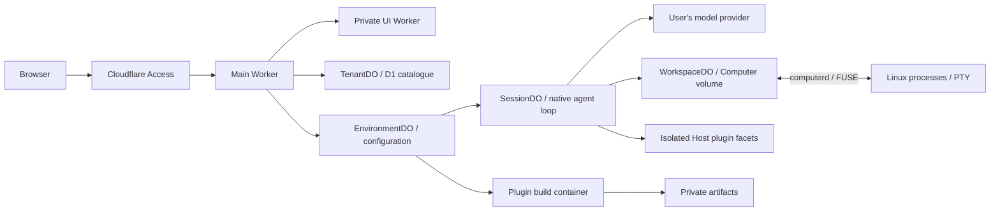

# Weft

**English** · [简体中文](README.zh-CN.md)

[](https://github.com/lacia-hIE/Weft/actions/workflows/test.yml) [](LICENSE)

**DeepSeek Harness, hosted on Cloudflare.**

Weft brings the original DeepSeek Harness agent loop, Web UI and Cordis plugin system to Cloudflare Workers, Durable Objects and Linux containers. Use an AI coding workspace from your browser, with persistent conversations, project files and real terminals.

Deploy to your own Cloudflare account, bring your model API keys, and control access through Cloudflare Access. Each user can maintain multiple environments with their own configuration, credentials, plugins and workspaces.

Weft is an independent adaptation of [DeepSeek Harness](https://github.com/deepseek-ai/deepseek-harness). It currently targets **DSH `0.2.1-rc.3`**, pinned by commit in [`upstream.lock.json`](upstream.lock.json). The frontend, Remote ABI, plugins and runtime are built from the same upstream source. See [compatibility](docs/architecture/upstream-compatibility.md) for upgrade boundaries.

## What you can do

| Capability | Behavior |
| --- | --- |
| Browser workbench | Original conversation, file, terminal, settings and plugin interfaces |
| Separate environments | Independent models, credentials, presets, plugins, sessions and workspace files |
| Environment lifecycle | Rename, suspend, resume and delete; copy configuration and persistent files with progress and retry |
| Persistent conversations | History, search, queues, cancellation and recovery |
| Model providers | Configure DeepSeek, OpenAI, Anthropic and other providers in native Models settings |
| Native agent features | Standard, PTC, minimal and creative presets, commands, plans, goals, skills and subagents |
| Linux execution | Git, Node.js, Python, real subprocesses and interactive PTYs in containers |
| Worker tasks and documents | Recoverable JavaScript tasks, native approvals and Office/PDF/image text extraction using Workers AI |
| Native Cordis bundles | Install npm packages declaring `dsh.bundle.patch`, or review and load agent-written plugins |
| Local DSH connection | Use your local Host's workbench, files, plugins and terminals through an outbound connection |

Environment copies exclude conversation history, managed credentials and running processes. Local Host connections support DSH `0.2.1-rc.2`, `0.2.1-rc.3` and `0.2.1-rc.4`, from `dsh web` or DeepSeek Harness Desktop.

## Quick start

Requirements: **Node.js 22.19+, npm and Git**.

```bash
git clone https://github.com/lacia-hIE/Weft.git
cd Weft
npm ci
npm run dev
```

Open `http://127.0.0.1:8787`, select or create an environment, and configure your provider, model, API key and HTTPS endpoint in **Settings → Models**. The first build fetches and verifies the pinned upstream checkout.

Local development uses a simulated identity on loopback only, initializes the local database automatically and stores state in `.cloudflare/local-state/`. It does not require a maintainer account or production deployment configuration. Worker shell, conversations, settings and Dynamic Worker plugins work locally; Linux containers and isolated npm compilation require a cloud deployment.

The homepage shows the signed-in user and your environments. Advanced YAML at creation uses the same validated `profile.yml` entries as the settings page. Environment menus provide rename, suspend/resume and confirmed deletion. Suspension preserves data; resumed terminals must be started again. The default environment cannot be deleted. See [environment lifecycle](docs/architecture/environment-lifecycle.md).

### Connect a local DSH Host

Choose **Connect local DSH** on the homepage and copy the pairing code. In your local DSH **Plugins → Add plugin**, install `@laciaproject/dsh-local-host`, enable it, paste the code into its configuration and select **Save and connect**. The plugin saves configuration on the local machine; no JSON download is needed.

Run the original `dsh web` locally. Weft relays the local Host's own workbench and client plugins rather than substituting the cloud runtime. Deployment owners must configure the device endpoint's Access routing first. See [local Host setup](docs/deployment/local-host.md).

## Deploy to Cloudflare

You need your own domain and an account with the required Workers, Durable Objects, D1, private R2, Worker Loader, Images, Workers AI and Containers services available. Configure Cloudflare Access to protect the application.

1. Create an Access application, D1 database and private R2 bucket; apply database migrations.
2. Copy [`deployment.example.json`](deployment.example.json) to the ignored `.weft/deployment.json`, then fill in your own resource details.
3. Run the **Test** workflow on `ci`; publish its verified container images to your own Cloudflare registry.
4. Build with the complete private deployment configuration, then deploy the private UI Worker followed by the main Worker.

See the **[deployment guide](docs/deployment.md)** for commands, configuration fields, image publication and Workers Builds automation. Deployment configuration can also be supplied as a complete `WEFT_DEPLOY_CONFIG` JSON build variable. Model credentials belong in each environment's Models settings.

**One-click deployment:** Cloudflare has an official [Deploy to Cloudflare](https://developers.cloudflare.com/workers/platform/deploy-buttons/) flow. It does not yet provision this entire project: Weft has two Workers, an Access application and verified private container images. Follow the deployment guide for initial setup; subsequent `main` updates can deploy automatically with Workers Builds. See [the deployment constraints](docs/deployment.md#deploy-to-cloudflare).

## How Cloudflare replaces local dependencies

Weft keeps upstream Harness and Cordis interfaces while adapting storage, execution and identity to Cloudflare services.

| Local dependency | Cloudflare replacement | Responsibility |
| --- | --- | --- |
| HTTP server | Workers | Authenticate and route HTTP, SSE and WebSocket requests |
| Static file server | Workers Static Assets + service binding | Serve the original UI from a private companion Worker |
| In-process agent and service instances | Durable Objects | Coordinate environment/session services and concurrent operations |
| Configuration files and credential stores | EnvironmentDO SQLite | Own settings, presets, workspace registration, credentials and plugin approvals |
| Conversation logs | SessionDO SQLite | Persist native session events and service state |
| User/environment directory | D1 | Track tenant ownership and platform environment metadata |
| Workspace disk | WorkspaceDO SQLite + `@cloudflare/computer` | Persist source files and `.git`; expose native FileSystem APIs |
| Bash, Git, Node.js, Python and PTYs | Cloudflare Containers | Run real Linux processes with a computerd/FUSE workspace mount |
| Generated code and external Host plugins | Dynamic Workers / Worker Loader | Run isolated code with scoped service bridges and approved capabilities |
| npm compiler and artifact directory | Separate build container + private R2 | Compile locked dependencies offline and store immutable artifacts |
| Local image libraries | Images binding | Decode, resize and encode model-ready image attachments |
| Office extraction CLI | Workers AI Markdown Conversion | Extract document text in Workers with `AI.toMarkdown`; extract PPTX text before conversion |
| Reminder timers | Durable Object Alarms | Persist schedules and wake session services for delivery |
| Local user identity | Cloudflare Access | Enforce login policy and tenant/environment authorization |



An agent's file operations go through the native FileSystem interface to WorkspaceDO. Commands that need system tools run in a container using the same volume. Conversation events are saved and streamed back through the original protocol.

D1 owns the platform catalogue; environment-internal operations use their own Durable Object storage. Source files and `.git` persist independently of the Linux container. Container-local dependencies such as `node_modules`, `.venv` and caches must be recreated after instance replacement. Running processes, PTYs and ordinary JavaScript memory are not persistent state.

The current storage layout is `harness-v2`. Moving from the historical v1 layout resets environment-internal data; routine updates within v2 do not repeat that reset. See [storage ownership and the historical reset](docs/architecture/environment-storage.md) before upgrading an old deployment.

### Execution modes and workspaces

| Mode | Execution |
| --- | --- |
| Auto | Start with Worker shell; the agent switches to a container when the task needs it |
| Worker only | Use supported lightweight shell commands without starting Linux |
| Always container | Use real Linux commands and interactive terminals |

Select the mode and container size in **Plugins → Workspace runtime**. Worker shell interprets supported commands in a Dynamic Worker; Git, Node.js and Python require the container. Containers sleep after ten idle minutes; persisted workspace data remains available.

Recoverable JavaScript tasks use `javascript_task`, also available to Code Mode. Workers AI handles Markdown conversion, while agent inference uses your configured model provider. See [Worker tasks and documents](docs/architecture/worker-tasks-and-documents.md).

Use **Add workspace** in the workspace menu to browse existing `/workspace` subdirectories, create a directory or enter a path. New sessions start in that directory; file views, terminals and workspace membership survive refresh. Removing a workspace entry preserves files and conversation records. Directories in one environment share its access boundary and default volume/container; use separate environments when you need independent configuration and resources.

## Plugins

Use the original `package.json.dsh.bundle.patch` declaration and standard Cordis exports:

```json
{
  "name": "my-dsh-plugin",
  "version": "1.0.0",
  "main": "./index.js",
  "dsh": {
    "bundle": {
      "patch": "./cordis.patch.yml"
    }
  }
}
```

Install public npm bundles through **Plugins → Add plugin**. The installer locks dependencies, validates archives and compiles in isolation. Packages start disabled: inspect the patch, code, digest and requested capabilities before approval.

Creative mode can also produce Host and Client Cordis plugins. Host code runs behind scoped service bridges; Client code executes in the workbench page. Native declarations, configuration validation and lifecycle remain authoritative. See [installation and compatibility](docs/validation/package-installation.md), [official bundles](docs/validation/official-bundles.md) and [plugin composition](docs/architecture/plugin-composition.md).

Third-party bundles can also use an environment-owned Worker Host for persistent domain state, background callbacks, approved HTTPS requests, scoped Session Controller operations and plugin-authenticated Webhook routes. Review these permissions in the existing package details. See [Worker Host services and limits](docs/architecture/worker-host-plugins.md); this does not provide a complete Node host.

## Limits compared with local DSH

- Synchronized workspace files have a **256 MiB per-file limit**. Large Git packs can exceed it; see [Git workspace guidance](docs/architecture/workspace-git.md).
- Container replacement ends processes and PTYs. Commands are not replayed automatically.
- Container-local dependencies are outside the persistent volume and are unavailable to Worker file tools.
- Plugins needing native extensions, unsupported Node APIs or services without a bridge may not work. `nodejs_compat` does not supply a complete local Node host.
- Port previews, Office-to-PDF conversion and additional local Host services are not fully integrated.

## Contribute

Read [CONTRIBUTING.md](CONTRIBUTING.md) for architecture boundaries and verification, and [SECURITY.md](SECURITY.md) for private vulnerability reporting. Issues and pull requests can be written in English or Chinese.

Tests run on pull requests, the `ci` branch and manual dispatch. They cover builds, types, workerd, browsers, offline plugin compilation and real container processes, PTYs, Git and FUSE. Ordinary CI does not need Cloudflare credentials or model keys. A push to `main` does not run the test workflow; the exact candidate commit is verified before merging.

| Path | Purpose |
| --- | --- |
| `apps/worker` | HTTP entry point and Durable Object wiring |
| `apps/web`, `apps/assets` | Web entry points, native extensions and private UI assets |
| `apps/workspace-container`, `apps/plugin-builder` | Linux execution and isolated plugin compilation |
| `packages` | Harness adapters and platform services |
| `migrations` | Ordered D1 migrations |
| `scripts`, `tests` | Upstream preparation, builds, releases and regression coverage |

## Versions and releases

Weft uses **`vX.Y.Z`** tags. The local connector independently uses **`dsh-local-host-vX.Y.Z`**; its npm version is not the Weft version. The current project version is `0.1.0`. During 0.x development, release notes describe compatibility changes and required deployment steps. The upstream DSH version is pinned separately.

[Changelog](CHANGELOG.md) · [GitHub Releases](https://github.com/lacia-hIE/Weft/releases) · [Release procedure](docs/releases.md).

Project releases require complete CI for the exact commit on `main`. GitHub source archives do not contain private deployment configuration or production-ready generated Workers.

## Documentation and license

- [Deployment](docs/deployment.md) and [local Host connection](docs/deployment/local-host.md)
- [Environments](docs/architecture/agent-environments.md) and [environment copying](docs/architecture/environment-copy.md)
- [Processes and PTYs](docs/architecture/workspace-processes.md)
- [Browser performance](docs/architecture/browser-performance.md)
- [Upstream compatibility](docs/architecture/upstream-compatibility.md)

Most detailed deployment and architecture documents are currently in Chinese. `docs/validation/` contains implementation and historical validation records; use the README and deployment guide for current instructions.

Weft is licensed under [MIT](LICENSE). Thanks to DeepSeek Harness and the Cloudflare open-source projects. Upstream code and dependencies retain their own licenses; see [THIRD_PARTY_NOTICES.md](THIRD_PARTY_NOTICES.md). Builds include `/licenses.txt` with third-party notices.
