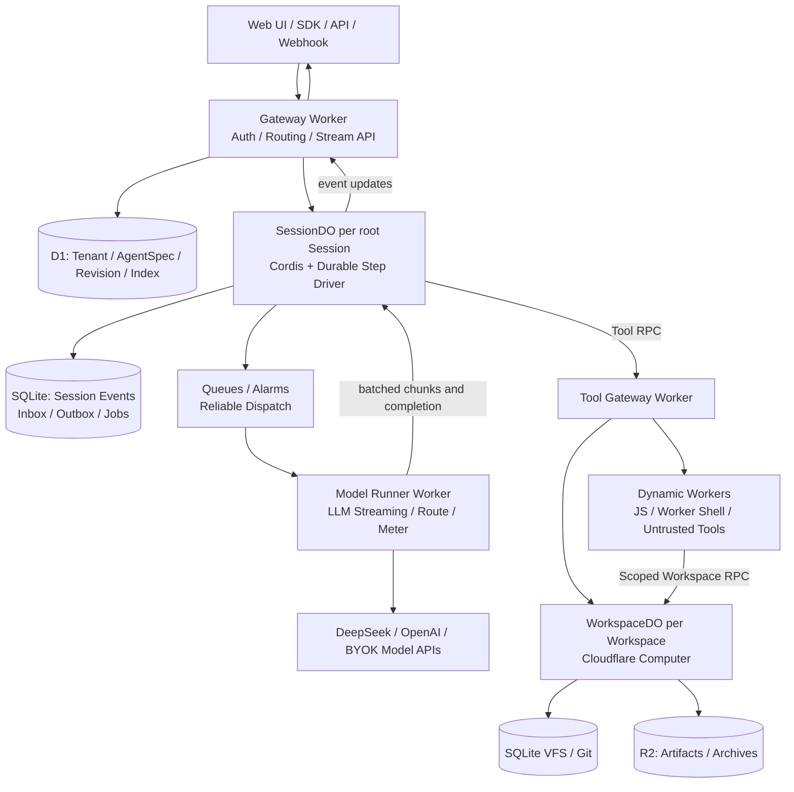

# Weft — 可组合、零常驻的 Agent Fabric

> **产品设计与技术架构 RFC**  
> 版本：v0.1 · 状态：Proposed · 日期：2026-10-16  
> 口号：**自由构建 Agent，只为实际执行付费。**  
> 英文：*Compose freely. Pay for work, not idle time.*
>
> **名称说明：** Weft 意为织物的「纬线」，寓意用模型、工具、技能、工作区和流程编织 Agent。这是项目工作名，域名、商标和开源项目重名尚未完成核验。

> **2026-10-17 产品边界更新：** Weft 管理多套 Harness 环境；Agent 列表中的一个 Agent 对应一套独立 Environment，用户进入后使用完整官方 Harness Web UI。环境内部的模型、插件、预设、会话和工作区沿用 Harness 的组织方式。Environment、Harness 预设和 Session 是三个不同层次。当前优先验证原生运行、隔离、插件生态与代码可维护性，成本优化后置。旧数据可以清理，不要求兼容或迁移；当前采用全新的原生数据布局。下文的异步 Model Runner、预算和产品扩展保留为提案，不作为当前已实现能力；具体实现及官方 UI 剩余验收以 [多环境与官方 UI](docs/architecture/agent-environments.md) 为准。

## 0. 一页决策

**Weft 不是一个“帮用户开通 AI 聊天页面”的 SaaS，也不是把 DeepSeek Harness 运行在 Cloudflare Container 里。** Weft 是一个让用户**自由拼装、运行、复用和发布 Agent** 的云原生运行平台：保留 Cordis 的插件机制与 DeepSeek Harness 的 Agent 行为契约，将执行驱动改造成适用于 Durable Objects 的**可恢复、零常驻状态机**，并用 Cloudflare Computer 提供持久工作区与无容器工具执行。

**决策：**

1. **绝不依赖 Container / 常驻 Node.js / 常驻 VM。** Cordis Core、Agent Runtime 与 Workspace 均原生部署于 Workers、Durable Objects 和 Dynamic Workers。
2. **先天解耦：Agent Definition ≠ Agent Session ≠ Computer Workspace。** 定义可无限复用，Session 可以休眠，Workspace 只在确实需要文件操作时激活。
3. **一个根 Session 对应一个 `SessionDO`，一个 Workspace 对应一个 `WorkspaceDO`。** 从第一版就采用双对象边界，而非先做单体后再拆。
4. **插件配置动态，可信插件代码预编译；不可信脚本只在隔离 Dynamic Workers 中运行。** 用户可在 UI 中无限组合 Agent，不需要为每个 Agent 重新发布平台 Worker。
5. **成本是产品的一等公民。** 平台侧不预留专属机器，模型采用 BYOK、多模型路由、预算上限、工具结果截断、按需执行和费用可观测；每次任务启动前可以预估预算。
6. **拒绝伪兼容。** POSIX Shell、原生 `node_modules` 编译、任意二进制与 PTY 不属于纯 Workers 保证能力。用 Computer 的 Worker Shell / Worker JavaScript / Git 替代，界面明确展示兼容边界。
7. **不在 SessionDO 内长时间等待模型网络响应。** 核心 Agent 决策在 DO；耗时推理由无状态 Model Runner 执行，异步回写结果。为此需要适配/重构 DeepSeek Agent Loop 的驱动层，而非仅换一个 Provider。

**核心指标（产品目标，不是现有能力承诺）：**

- **组合自由度：** 非程序员可通过表单/图形视图创建 Agent；开发者可用 YAML/SDK、插件和受控 JavaScript 扩展能力。
- **成本透明度：** 每个 Agent、Session、Tool、模型步骤均可见分项成本与预算余量。
- **空闲成本：** 没有持续执行的任务时，不产生专属计算资源的常驻计费；仍可能有数据存储、账号套餐和极少量后台调度费用。
- **可靠性：** 已确认持久化的事件不丢失；重复投递、重试和 DO 重建不导致 Session 事件错序或可避免的重复副作用。
- **可移植性：** Agent 规格、插件接口、Session 导出使用公开版本化格式，不把用户锁死在单一 UI。

---

## 1. 产品定位与用户问题

### 1.1 目标用户

| 人群 | 目标 | 当前痛点 | Weft 提供 |
|---|---|---|---|
| 独立开发者 | 快速做一个能执行任务的 Agent | 需要自建后端、数据库、事件流、工具沙箱 | 配置即 Agent、部署即 API |
| 高级 Agent 构建者 | 自由组合模型、提示词、工具、技能和子 Agent | 框架过于一体化、换组件困难 | Cordis 插件组合、版本化 AgentSpec |
| 小团队 | 用低成本部署多个项目 Agent | 空闲服务器贵、Agent 状态管理繁琐 | 唤醒执行、空闲休眠、工作区复用 |
| 自动化开发者 | Webhook/定时任务触发 Agent | 后台任务恢复、权限与成本不可控 | Durable Job、预算、触发器、审计 |
| 平台开发者 | 将 Agent 嵌入自己的产品 | 自建运行时、多租户和流式 API | API/SDK/嵌入式 UI/远程工具协议 |

### 1.2 产品承诺

- **Build Anything（构建自由）**：模型、Prompt、Tool、Skill、Memory、Workflow、触发器和 Workspace 是独立可组合的能力。
- **Run Anywhere at the Edge（无服务器运行）**：用户创建 Agent 定义不等于启动进程；在事件、请求或定时触发时才调度执行。
- **Know Every Dollar（成本明确）**：从 Agent 创建到每一步执行都有成本策略；模型费用、平台费用和第三方 API 费用分列。
- **Own Your Agent（可迁移、可审计）**：版本化配置、Session 导出、工作区快照、插件授权清单与执行轨迹。

### 1.3 明确不做的事

- 不承诺在 Workers 中运行任意 Linux 软件、完整 Bash、Docker、Chrome 进程或原生 Node.js CLI。
- 不默许用户上传的任意 npm 插件直接在持有 Secret 的 Cordis Root Context 中运行。
- 不承诺“绝对最低总成本”；最低成本依赖模型选择、调用次数、数据规模和负载形态，应通过同任务基准测量。
- 不把“Session 历史恢复”宣传成“任意外部副作用严格 exactly-once”。

## 2. 核心产品概念

| 概念 | 定义 | 持久性 / 归属 |
|---|---|---|
| **Agent Definition** | 可复用的 Agent 规格：目标、Prompt、模型策略、工具、技能、触发器、预算 | D1 中的业务实体 |
| **Agent Revision** | 不可变、可追溯的发布快照 | D1；按 hash/version 固定依赖 |
| **Session** | 某次对话或任务的事件日志、执行状态与 Inbox | `SessionDO` SQLite |
| **Cordis Runtime** | 临时装配的插件上下文、服务和 Agent 行为 | `SessionDO` 内存，随唤醒重建 |
| **Workspace** | 项目文件、Git、运行输出和工件的独立持久空间 | `WorkspaceDO` + Computer SQLite |
| **Skill** | 可移植的任务知识、Prompt 片段、工具组合或受控代码 | 版本化 Registry / R2 |
| **Plugin** | 为 Cordis Service/Event/Tool 提供能力的扩展 | 可信预构建插件或受控动态工具 |
| **Run / Job** | 一次可重试、可检查点化的执行 | `SessionDO` 事务记录 + Queue/Workflow |
| **Capability Grant** | 授予某次执行的最小权限 | 按租户、Agent Revision、Run 策略生成 |

**核心关系：** 一个 Agent Definition 能创建许多 Session；一个 Workspace 能被多 Session 引用；Session 与 Workspace 可分别休眠。Agent Revision 在 Run 开始时固定，避免中途插件热变更造成不可重放的行为差异。

## 3. 产品体验与信息架构

### 3.1 顶层导航

1. **Explore / Templates**：从 Coding Agent、研究 Agent、客服 Agent、Webhook Agent、数据处理 Agent 模板开始。
2. **Agents**：列表、复制、版本、发布状态、调用入口与单位运行成本。
3. **Agent Studio**：画布视图与 YAML 视图双向同步，提供模型/工具/技能/工作区/权限/成本配置。
4. **Playground**：运行 Agent，流式查看消息、Tool 调用、文件 Diff、事件轨迹和费用。
5. **Workspaces**：文件浏览、Git、工件、权限、快照与共享关系。
6. **Runs**：跨 Agent 执行历史、重试、暂停、人工批准、回放与失败诊断。
7. **Plugins & Skills**：检索、安装、授权、测试和版本固定。
8. **Usage & Budgets**：模型 Token、DO 活动、Dynamic Worker 创建量、R2 存储、预算警报。

### 3.2 创建 Agent 的最低摩擦路径

**新建 → 描述目标 → 选模型策略 → 选工具/Skill → 设置权限和预算 → 运行 → 发布。**

- 默认模板不要求用户理解 Cordis 或 Cloudflare。
- 高级模式允许配置插件依赖图、生命周期钩子、模型路由策略、子 Agent 和自定义脚本。
- 同一个 Agent 有三种视图：**表单**（易用）、**图形组合**（结构）、**YAML/SDK**（精确与可复现）。
- 任何危险权限（联网写操作、文件删除、密钥访问、对外发布）都明确展示授权范围。

### 3.3 运行体验

- 聊天与自动化任务共用 Session Event Log。
- 显示：正在使用的模型、当前步骤、工具参数/结果、文件 Diff、预算余量、是否等待用户批准。
- 断线后 UI 通过快照和序列号恢复，不通过重放模型调用恢复聊天窗口。
- 支持从某次运行 Fork 到新的 Session，继承指定事件前缀和可选择的 Workspace 快照。
- 成本策略允许：最低成本、均衡、质量优先、自定义，用户始终可锁定模型。

## 4. AgentSpec：可组合配置是产品的核心 API

下面是 **Weft 建议定义的 AgentSpec v1**，不是 DeepSeek Harness 目前已有的官方 YAML schema：

```yaml
apiVersion: weft.dev/v1
kind: Agent
metadata:
  name: repo-maintainer
  visibility: private
spec:
  description: 阅读项目、定位问题、修改文件、展示 Git Diff
  model:
    strategy: budget-aware
    providers:
      - id: deepseek
        model: deepseek-chat
      - id: alternate
        model: user-configured-model
    constraints:
      maxCostUsdPerRun: 0.50
      maxSteps: 24
      maxOutputTokensPerStep: 4096
      allowAutomaticProviderFallback: false
  prompt:
    system: |
      你是审慎的仓库维护 Agent。提交改动前必须展示 diff。
  plugins:
    - id: weft.core.agent-loop
      version: "1.x"
    - id: weft.computer.tools
      version: "1.x"
  skills:
    - ref: registry://skills/code-review@sha256:example
  tools:
    allow: [fs.read, fs.edit, fs.grep, git.status, git.diff, js.exec]
    requireApproval: [git.push, fs.delete]
  workspace:
    mode: persistent
    sharing: project
  triggers:
    - type: manual
    - type: webhook
      path: /hooks/repo-maintainer
  execution:
    mode: durable
    concurrency: per-session
    retryPolicy: idempotent-only
    timeoutSeconds: 900
  security:
    network: deny-by-default
    secrets: [github-token]
    filesystemRoots: [/workspace]
```

**编译/发布流程：** `AgentSpec` → Schema 验证 → 解析插件依赖与权限 → 生成不可变 Agent Revision → 建立 `PluginPlan` → 运行时构造 Cordis Context。**配置动态**不等于**运行时下载任意 JS 到可信 Worker**。

### 4.1 插件分级

| 类别 | 作者自由度 | 执行位置 | 安全与发布约束 |
|---|---|---|---|
| 核心插件 | 平台维护 | `SessionDO` Cordis Context | 静态构建、严格测试 |
| 认证第三方插件 | 公开仓库，经平台审核 | 预构建可信 Bundles，或隔离 Adapter | 版本锁定、签名/代码审查 |
| 用户 Tool Script | 用户自定义 JS | Dynamic Worker | 显式 Capability、资源/网络限制 |
| 远程工具/MCP | 用户提供 Endpoint | 无状态 Tool Gateway | egress allowlist、认证与配额 |
| Skill / Prompt | 任意文本、结构化配置 | 编译为受限 Context 贡献 | 最大长度、来源标识与权限检查 |

**重要限制：** 浏览器端 Cordis UI 扩展、服务端 Cordis 扩展、Dynamic Worker 脚本是三种不同的边界；不能将“可安装插件”等同于“用户代码获得宿主全权”。

## 5. 目标架构：全原生 Cloudflare，无 Container



### 5.1 各组件职责

**Gateway Worker**
- OAuth/身份验证、租户/组织 RBAC、API Key 和 rate limit。
- 解析 `AgentRevision`、`SessionId`、`WorkspaceId`；不创建全局共享 Agent 对象。
- 提供 Web UI 的 Remote 兼容层、WebSocket Hibernation 接入和 HTTP/SSE API。

**SessionDO（Agent 控制面 + 权威日志）**
- 按根 Session ID 唯一寻址，持有该 Session 的 Cordis Context 和 Agent 内存对象。
- 管理 Inbox、步骤状态、事件序列、模型请求意图、预算锁定、工具状态与重试决策。
- **只执行短时间的规划/提交/事件处理**，不长期 `await fetch(LLM)`。
- 休眠后重新装配 Cordis，重放必要事件与执行检查点。

**Model Runner Worker（无状态推理执行器）**
- 接收带版本、配额、租户令牌和幂等 ID 的模型调用意图；用 `fetch()` 执行流式模型请求。
- 分批回写实时 Chunk（例如按时间或字节阈值）以及最终结果与精确 Token 用量。
- 不持有 Agent 的真实状态，也不能任意写入 Session Event Log。
- 无状态 Workers 主要按请求/CPU 计费，但第三方 LLM 与队列等费用单独计入；这不是“模型推理免费”。

**Tool Gateway Worker（策略执行点）**
- 决定工具是否被允许、是否需要 Human Approval、能否使用指定 CredentialRef。
- 将文件 / Git 请求路由至 WorkspaceDO，将用户代码路由至 Dynamic Worker，将 Web API Tool 路由至受控 `fetch()`。

**WorkspaceDO（Computer 工作区数据面）**
- SQLite VFS 是权威文件状态；提供 `workspace.fs`、`workspace.git` 和执行后端。
- Workspace 只在首次文件操作时分配/激活；**纯问答 Agent 不创建 Workspace**。
- 保持独立文件修订与操作日志，支持多 Session 引用、权限检查、分支/冲突防护。

**D1 / R2 / Workflow / Queue**
- D1：用户、AgentSpec、版本、发布索引、权限索引和 Run 检索索引，避免冷会话列表扫描所有 DO。
- R2：较大附件、导出、归档、工件与快照，尽量不把大文件全部塞进 DO SQLite。
- Queues + DO Alarms：至少一次投递与 Outbox 恢复；Workflow 用于复杂跨步骤等待、审批超时和长周期触发（按需选用）。

### 5.2 为什么不是“一 Agent 一个常驻 DO”

Agent Definition 可能有数十万份，大多数几乎不运行。Weft 不为定义创建长驻的 Cordis Runtime。只有被调用的 Session 才有逻辑 SessionDO；其热内存生命周期与业务定义解耦。一个 SessionDO 只用自己的权威日志；同一 Workspace 的文件统一由 WorkspaceDO 管理。

### 5.3 Cordis 运行时装配

```text
SessionDO (wake)
  ├─ load AgentRevision + immutable PluginPlan
  ├─ initialize Cordis Root Context (trusted worker-safe plugins)
  ├─ install Session Persistence / Prompt / Tools / LLM route
  ├─ restore Session projection / Inbox / pending jobs
  ├─ create or resume logical Agent scope
  ├─ process one durable state transition
  └─ release idle timers and become hibernatable
```

不序列化 Cordis 对象，也不依赖进程全局单例、Node.js 动态 require、磁盘 Profile 或原生 Subprocess。

## 6. 最大的运行时创新：Durable Step Driver

DeepSeek Harness 的默认 Agent Loop 是围绕连续的 Step/Turn、模型流和 Tool 调用设计的。若直接在 DO 中等待几十秒的模型调用，**DO 等待外部 I/O 期间仍可能持续产生 Duration 费用**。要真正优化成本，应保留其 Cordis Service/Event 模型、Session 事件格式与工具约定，**重构执行 Driver 为可检查点的短事务状态机**。

### 6.1 单步流程

```mermaid
sequenceDiagram
  participant C as Client
  participant S as SessionDO
  participant Q as Queue
  participant M as Model Runner Worker
  participant T as Tool Gateway / WorkspaceDO

  C->>S: send(sessionId, user input)
  S->>S: persist inbox + step intent + outbox
  S-->>C: ack + stream cursor
  S->>Q: dispatch intent (retryable outbox)
  Q->>M: invoke model (stepId, attemptId)
  M->>M: fetch LLM stream
  loop bounded incremental chunks
    M->>S: publish ephemeral chunk batch
    S-->>C: realtime display
  end
  M->>S: complete(response, usage, attemptId)
  S->>S: append assistant event; decide next tool calls
  S->>T: execute authorized tool (operationId)
  T-->>S: tool result / side effect receipt
  S->>S: append tool result + checkpoint
  S->>S: next step or turn/end
  S-->>C: durable update + billed usage
```

> 该时序图是**计划实现的协议**，不是现成的 DeepSeek/Cloudflare API。生产实现中，长任务经 Queue/Workflow 分段执行；短 Tool RPC 也可使用异步投递，避免保持 DO 活动。实时块仅作展示，持久记录采用完整消息与运行状态检查点。

### 6.2 状态机

```text
PENDING → PREPARING → MODEL_DISPATCHED → MODEL_COMPLETE
                                     │
                                     └→ MODEL_FAILED → RETRY_OR_HALT
MODEL_COMPLETE → TOOL_DISPATCHED → TOOL_COMPLETE → NEXT_STEP | DONE
                             │
                             └→ APPROVAL_REQUIRED → APPROVED | REJECTED
```

每次状态转换在 `SessionDO` SQLite 中原子提交，包括：`run_id`、`turn_id`、`step_id`、`attempt_id`、`expected_seq`、`revision`、`outbox`、`budget_hold` 和 `checkpoint`。

**关键约束：** `MODEL_COMPLETE` 不意味立刻持久化每一个直播 Token；只有经过完整响应校验与完成事件确认后才生成对应 `assistant/message`；失败路径用相容的 attempt/interruption 语义表达。

### 6.3 可靠投递与幂等

- Queue 是**至少一次**投递，所有 Runner 回调携带 `runId/stepId/attemptId` 与签名/内部 Service Binding 身份。
- `SessionDO` 只接受当前有效 Attempt 的完成事件；旧 Attempt、乱序回调和重复工具结果可幂等拒绝或返回已提交回执。
- 事务先写 Outbox，后由 Alarm/Queue 投递；投递失败重放 Outbox，不丢任务。
- 外部副作用的 Tool 以 `operationId` 调用，优先使用目标服务幂等接口或查询回执。不能保证幂等的操作须允许用户确认，不声称 exactly-once。
- DO 休眠/重建后恢复的是**持久状态机**，不是丢失的 JavaScript Promise。
- 子 Agent 作为 Tool/Run 可以由新 Session 派生；父子生命周期通过 durable lineage 和明确预算传递，不使用跨 DO 共享可变 Agent 对象。

### 6.4 Web UI 实时性与成本折中

- 模型 Chunk 在 Runner 内做 **100–250ms / 1–4KB 自适应批处理**（初始实验参数，须压测调优），而非每个 Token 向 DO RPC。
- Web UI 可以收到实时 Chunk，但在断线恢复时以 Session durable journal 为准。
- 连接采用 DO WebSocket Hibernation；不保留无意义心跳、定时器、持久外连，也不以永久打开的请求维持 Agent 活性。
- 持续模型流阶段由无状态 Runner 保持 I/O；DO 仅在接收批次/完成事件时短暂唤醒。该设计是否比直连 DO 更便宜，必须用账单与压测验证（RPC 次数与批处理也有成本）。

## 7. Computer Workspace 与无容器工具环境

### 7.1 Computer Provider

计划实现适配包（建议命名）：

```text
@weft/plugin-computer
├── FileSystemProvider: ctx.fs → workspace.fs
├── GitToolProvider: tools.git.* → workspace.git
├── JsExecutionProvider: js.exec → WorkerJavaScriptBackend
├── ShellToolProvider: shell.exec → WorkerShellBackend (受限能力)
├── PermissionBridge: Capability Grants / Path Roots
└── Diff / Artifact / Workspace Version Bridge
```

**兼容策略：** 先实现完整的文件读写、编辑冲突检测、搜索、Git 与 JS Tool 契约；Shell 对外只声明 `worker-shell` 而非冒充“任意 Bash”。

### 7.2 共享 Workspace

- 工作区使用稳定 `workspaceId`，路径 `/workspace/...` 为虚拟路径，映射到 Computer VFS，而非某个临时容器的物理路径。
- WorkspaceDO 为写入命令生成单调 `workspaceRevision`；读返回 `fileVersion`，写操作可提供 `expectedVersion`。冲突返回 `409`，由 Agent 决定重试、合并或人工确认。
- 大型仓库可通过只读 R2 挂载、筛选导入、懒加载、搜索索引、工件归档降低 SQLite 与动态执行开销。
- Git 由 isomorphic-git 适配提供，可支持基础 status/diff/commit；不能依赖不存在的原生 Git Worktree 或 Hook 能力。

### 7.3 Dynamic Workers：自由但受限

| 任务 | 默认后端 | 说明 |
|---|---|---|
| 读取/编辑文件 | Computer FS RPC | 不必启动 Dynamic Worker |
| Git diff/commit | Computer Git API | 不必启动 Shell |
| 任意数据转换脚本 | WorkerJavaScriptBackend | 隔离 JS，给最小能力 |
| 文本 Shell 管道 | WorkerShellBackend + just-bash | 不等于 POSIX/Linux |
| 第三方 API Tool | Tool Gateway + fetch | 需访问策略与凭据代理 |
| 任意原生二进制 | **不支持** | 这是纯 Workers 的明确产品边界 |

**Dynamic Worker 成本关键：** 对可复用的可信代码版本与固定权限策略优先使用稳定 ID 的 `loader.get()`；对确实一次性的、模型生成代码使用隔离的 `load()` 并限制次数。当前官方计费中，`load()` 每调用一次会计入新的 Dynamic Worker 创建量，不能把“动态隔离”当成无成本机制。

## 8. 多租户安全模型

### 8.1 四道强制边界

1. **Identity：** 每次入口认证并解析 `tenantId/userId/agentRevisionId/sessionId`；所有下游服务授权使用这些显式身份，禁止只凭可猜测 ID 访问 DO。
2. **Trusted/Untrusted Code：** 宿主 Cordis 只运行审核过的 Worker-safe 插件；用户 JS 与第三方未知代码必须进隔离 Dynamic Worker。
3. **Capability：** 允许的 Workspace Root、Read/Write、Git、网络域名、CredentialRef 和最高费用在每次执行前重新核验。绝不给用户代码传整个 `env` 或无范围 DO stub。
4. **Approval：** 删除、发布、发送消息、提交 PR、支付、写外部系统等有副作用动作支持审批策略；拒绝后留审计事件。

### 8.2 Secret 处理

- 用户配置保存 Secret 引用而不是值；密钥在可信的 Credential Broker 中按需解封/代理调用。
- Runner 与 Dynamic Worker 默认拿不到未声明的 Secret；绝不把平台主密钥放入 Prompt、工具返回或前端。
- BYOK 是第一等能力：用户可配置模型 Provider 密钥，不经平台模型加价；平台也可提供托管模型额度作为可选方案。
- 最小授权、密钥轮换、审计、资源配额和主动撤销必须在公开 Beta 前实现。

### 8.3 防资源滥用

- 用户、组织、Agent、Run、Tool 多级硬预算；Token、步骤数、Runner 并发、执行时间、外网目标和 Dynamic Worker 创建量都可设上限。
- 对外请求限制 SSRF（私网/元数据地址）、凭据外传、恶意重定向与网络滥用；Dynamic Worker 默认禁外网，必要时经过策略网关。
- 扫描插件依赖、记录签名与版本；默认禁自我修改核心 Runtime 和权限策略。

## 9. 数据模型与一致性

### 9.1 D1：控制面索引（示意）

```sql
CREATE TABLE agent_definitions (
  id TEXT PRIMARY KEY,
  tenant_id TEXT NOT NULL,
  name TEXT NOT NULL,
  current_revision_id TEXT,
  created_at TEXT NOT NULL
);
CREATE TABLE agent_revisions (
  id TEXT PRIMARY KEY,
  agent_id TEXT NOT NULL,
  manifest_json TEXT NOT NULL,
  manifest_sha256 TEXT NOT NULL,
  created_at TEXT NOT NULL
);
CREATE TABLE sessions_index (
  id TEXT PRIMARY KEY,
  tenant_id TEXT NOT NULL,
  agent_revision_id TEXT NOT NULL,
  workspace_id TEXT,
  state TEXT NOT NULL,
  updated_at TEXT NOT NULL
);
CREATE INDEX idx_sessions_tenant ON sessions_index(tenant_id, updated_at);
```

### 9.2 SessionDO SQLite：执行事实

```sql
CREATE TABLE session_events (
  seq INTEGER PRIMARY KEY,
  event_type TEXT NOT NULL,
  payload_json TEXT NOT NULL,
  created_at TEXT NOT NULL
);
CREATE TABLE runs (
  run_id TEXT PRIMARY KEY,
  agent_revision_id TEXT NOT NULL,
  phase TEXT NOT NULL,
  current_step_id TEXT,
  budget_reserved_microusd INTEGER NOT NULL DEFAULT 0,
  updated_at TEXT NOT NULL
);
CREATE TABLE step_attempts (
  attempt_id TEXT PRIMARY KEY,
  run_id TEXT NOT NULL,
  step_id TEXT NOT NULL,
  state TEXT NOT NULL,
  result_hash TEXT,
  updated_at TEXT NOT NULL
);
CREATE TABLE outbox (
  dispatch_id TEXT PRIMARY KEY,
  topic TEXT NOT NULL,
  payload_json TEXT NOT NULL,
  delivered_at TEXT
);
```

这是业务表草图，最终还应包含 SessionHeader、协议版本、Checkpoint、Inbox、Writer/Fence、用户批准与操作结果。`SessionPersistence` Adapter 必须通过 DeepSeek 原有的 `create/open/stat/list/append/flush/close` 契约测试、序列连续性和损坏恢复测试。

### 9.3 跨对象一致性

跨 `SessionDO` 与 `WorkspaceDO` **不存在单个 SQLite 事务**。文件写入采用：

1. SessionDO 写入 `tool_intent(operationId, expectedWorkspaceRevision)`。
2. Tool Gateway 把带 `operationId` 的操作送到 WorkspaceDO。
3. WorkspaceDO 在本地事务中执行/记录操作结果，返回新 revision 或冲突。
4. SessionDO 追加 `tool/result` 及对应的 workspace receipt。
5. 若第 3 步成功、第 4 步之前失败，恢复时按 `operationId` 查询 WorkspaceDO 回执，不重复执行写入。

原则：**文件事实由 WorkspaceDO 决定，Agent 历史事实由 SessionDO 决定；通过可重复确认的操作回执实现最终一致。**

### 9.4 导出、删除与保留

- 支持 AgentSpec YAML、Session JSONL、Workspace 文件归档和使用记录导出。
- 用户可单独删除 Agent、Session 和 Workspace；共享 Workspace 需要引用检查或显式保留策略。
- 设置默认保留期、R2 冷归档、删除传播与权限撤销；不允许以删除 UI 条目冒充清除所有底层数据。

## 10. 成本架构：从技术指标变成产品优势

> **成本原则：先减少模型 Token，再减少重复执行，最后优化基础设施。** 小规模 Agent 的账单往往主要由模型 API 决定；未经过对照测试，不能宣称 Weft 的总成本一定低于其他平台。

### 10.1 总成本模型

```text
Cost(run) = LLM_input_tokens + LLM_output_tokens + LLM_cache_effect
          + Gateway_Workers_CPU_and_requests
          + SessionDO_requests_and_billable_duration_and_SQLite
          + WorkspaceDO_requests_and_billable_duration_and_SQLite
          + DynamicWorkers_creations_and_CPU_and_requests
          + Queue_or_Workflows + R2 + External_API
```

数据应按 **run / agent / tenant / calendar month** 四个粒度归集。模型费用区分平台托管费与 BYOK 的外部账单：平台看不到的 BYOK 费用标为估算，不声称实际扣费。

### 10.2 成本优化栈（优先级从高到低）

| 杠杆 | 具体机制 | 用户可见收益 |
|---|---|---|
| **BYOK + 多模型选择** | 每一步可选模型，锁定质量下限与最高价格 | 模型支出可控 |
| **预算感知路由** | 简单分类/抽取用低价模型，复杂规划升级 | 避免所有步骤用最贵模型 |
| **上下文预算** | 只载入有关工具与工作区文件，压缩过旧历史，按需检索 | 减少重复 Prompt Token |
| **缓存与复用** | 利用提供商兼容的 Prompt Cache、静态系统提示前缀、Tool 结果缓存 | 减少重复调用 |
| **按需 Workspace** | 纯聊天不创建 Computer Workspace，文件操作时再触发 | 降低状态与 I/O 开销 |
| **短事务 SessionDO** | 模型等待从 DO 转移至无状态 Runner，避免不必要的 DO Wall-clock | 降低 DO Duration 成本 |
| **Chunk 批处理** | 合并直播 Token 到较少回写 RPC | 降低请求数 |
| **复用 Dynamic Worker** | 可复用代码和授权策略采用稳定 Loader ID | 减少独立 Worker 创建计费 |
| **任务去重与停止策略** | 幂等重试、预算熔断、模型无限循环检测 | 避免隐形消耗 |
| **存储生命周期** | 小状态 SQLite，大附件 R2，长历史归档 | 降低长期存储 |

**反向约束：** 低价模型不是默认强制策略；质量、隐私、延迟可能优先于价格，用户应能锁定模型和数据区域要求。

### 10.3 官方计费基线（核对时间：2026-10-16）

下表仅供架构估算，**不是产品销售报价**。具体以 Cloudflare 账单和最新 Pricing 页面为准：

| 项目 | 当前公开计费摘要 | 设计启示 |
|---|---|---|
| Workers Standard | Paid 计划每月含 1,000 万请求、3,000 万 CPU-ms；超额按量 | 尽量由短 CPU 工作承载 I/O 流 |
| Durable Objects | Paid 含 100 万请求/月、40 万 GB-s/月；超额分别按量 | 空闲必须满足 Hibernation 条件 |
| DO SQLite | Paid 含一定读写行及 5 GB-month 存储 | 事件合并、索引读取与归档需要管理 |
| Dynamic Workers | 当前仅 Paid；每月含 1,000 个 Unique Dynamic Workers，超额 **$0.002/Worker/天**；请求/CPU 计入 Workers | **不要每个 Token/每次工具调用都 `load()` 新 Worker** |
| R2 | 标准存储按 GB-month 与操作数计费，公开网络出口免费 | 适合大型工件和归档，不适合频繁小对象往返 |

参考：[Workers Pricing](https://developers.cloudflare.com/workers/platform/pricing/)、[DO Pricing](https://developers.cloudflare.com/durable-objects/platform/pricing/)、[Dynamic Workers Pricing](https://developers.cloudflare.com/dynamic-workers/pricing/)。

**非常重要的成本事实：** DO 等待出站 I/O、`waitUntil`、持续计时器、标准 WebSocket 等可能使 DO 无法休眠，产生 Duration 账单；采用 WebSocket Hibernation、严格分离 Model Runner、禁止空闲定时器是设计要求，而非装饰性优化。

### 10.4 成本策略 UI

每个 Agent 可设置：

```yaml
costPolicy:
  modelMode: budget-aware # locked | budget-aware | quality-first
  hardLimitUsdPerRun: 0.50
  monthlyHardLimitUsd: 15.00
  maxModelSteps: 24
  maxDynamicWorkerCreatesPerRun: 4
  maxToolCallsPerRun: 80
  maxParallelJobs: 2
  onLimit: pause-and-ask # pause-and-ask | stop
```

- **创建前**：显示模板预估模型支出范围，不冒充确定性账单。
- **运行中**：显示分项预计支出、Token 实际用量、是否触发预算策略。
- **运行后**：展示实际可观察成本、估算项、用量差异与推荐优化方法。

### 10.5 基准测量与选择原则

至少比较三种实现：

- **A：DO 内直接 `await LLM`**（最简）
- **B：Runner 分离，Chunk 批处理回写 DO**（目标）
- **C：Runner 分离，纯完成事件回写，UI 直接读独立短流**（低回写对照）

采用同一模型/Prompt/工具和并发负载，观察：`$/successful run`、p50/p95 首 Token 延迟、DO 活跃 GB-s、DO RPC、动态 Worker 创建量、异常恢复成功率。**只有 B 在可接受体验下显著节约总成本时，才成为默认执行路径**；否则允许按负载类型路由 A/C。架构激进，但不能让架构信仰压过真实账单。

## 11. 对外 API、SDK 与发布方式

### 11.1 API（提案）

```http
POST /v1/agents                     # 创建 Agent Definition
POST /v1/agents/{agentId}/revisions # 发布不可变 Revision
POST /v1/sessions                   # 创建 Session（可懒激活）
POST /v1/sessions/{id}/messages     # 投递消息，返回 runId
GET  /v1/sessions/{id}/events       # cursor 分页/流式跟随
POST /v1/runs/{id}/cancel           # 请求取消
POST /v1/runs/{id}/approve          # 人工批准工具副作用
GET  /v1/runs/{id}/usage            # 用量和成本
POST /v1/workspaces                 # 建立工作区元数据
GET  /v1/workspaces/{id}/files      # 文件列表
POST /v1/workspaces/{id}/snapshot   # 快照/导出
```

外部 API 不直接暴露 Cordis Context 对象，内部优先通过 RPC 调用 Service；版本化 Remote 兼容层独立维护，以避免当前 DeepSeek WebBootGraph/Browser Cordis 协议紧耦合影响 UI 演进。

### 11.2 发布形态

- Private Agent（个人/团队内部）
- Public API Agent（API key + 限额）
- Embedded Chat Widget（嵌入其他应用）
- Webhook / Scheduled Agent（事件驱动）
- Agent as Tool（在另一个 Agent 中通过明确权限调用）
- 未来 MCP-compatible Server（需单独定义鉴权、长连接和流式协议）

## 12. 工程结构与边界

```text
weft/
├── apps/
│   ├── studio/                # React Builder, Playground, Usage
│   └── gateway/               # Workers API / Auth / Stream
├── runtimes/
│   ├── session-do/            # Cordis + Durable Step Driver
│   ├── workspace-do/          # Cloudflare Computer
│   ├── model-runner/          # Stateless LLM streaming
│   └── tool-gateway/          # Capability checks / Tool dispatch
├── packages/
│   ├── agent-spec/            # schema, compiler, immutable revisions
│   ├── cordis-workerd/        # bundling / lifecycle / timers audit
│   ├── dsh-adapter/           # Agent, Session, Tool, Event contract bridges
│   ├── session-persistence-do/# SQLite-backed SessionPersistence
│   ├── computer-provider/     # fs/git/js/shell adapter
│   ├── plugin-registry/       # manifests, version, permissions
│   ├── model-routing/         # BYOK, budgets, fallback
│   ├── cost-metering/         # token + infra dimensions
│   ├── protocol/              # RPC / event schemas / SDK types
│   └── sdk/                   # TS SDK
├── migrations/
├── tests/
│   ├── contracts/             # original Harness adapter contracts
│   ├── failure-injection/     # DO restart, timeout, duplicate callbacks
│   ├── security/              # capability and tenant isolation
│   └── cost-benchmarks/
└── docs/
```

**维护策略：** 对 DeepSeek 源码采用固定 commit/subtree 或可审查的补丁集；Cordis Core 尽量不 Fork，优先修改/替换依赖 Node 的外围插件与 Agent Driver。不得声称与原版 `dsh web` 所有插件二进制或行为 100% 兼容。DeepSeek Harness 本身仍为实验性预览项目；Weft 应单独做安全审查和生产就绪评估。

## 13. 激进版本的交付路径（不是 Container 过渡计划）

**所有阶段均坚持纯 Workers 架构；阶段划分只为验证不可约的技术风险，不引入 Node Host 生产兜底。**

| 里程碑 | 交付结果 | 阶段验收 |
|---|---|---|
| **M0 — Workerd Kernel** | Cordis Context、Effect/Scope、核心 Session/Tool/Agent 可打包至 workerd | 能创建/销毁 Context、加载两个 AgentSpec、无 Node-only import |
| **M1 — Full Vertical Slice** | SessionDO + WorkspaceDO + Computer + Model Runner + Web UI 最简版 | “读仓库 → 修改文件 → 展示 Diff → Commit”全流程无 Container |
| **M2 — Durable & Secure** | Step Driver、Outbox、Budget、Secrets、Tool Capability、重复投递恢复 | DO 强制重建后数据连续，外部操作回执不重复 |
| **M3 — Agent Studio** | 表单/画布/YAML、模型路由、插件/Skill、版本发布、多 Agent 组合 | 不改平台代码即可组合并发布新 Agent |
| **M4 — Cost Engine** | BYOK、成本明细、缓存、Context 缩减、运行成本 AB 实验 | 可复现实验报告证明至少一个主力负载成本下降 |
| **M5 — Public Beta Gate** | 多租户权限、审计、备份、配额、压测、故障演练与文档 | 风险登记项关闭或明确标注已知限制 |

### 13.1 必须优先跑通的端到端验收故事

> 用户从模板创建一个 Agent，选择自己的 DeepSeek API Key，授予特定 GitHub 仓库只读和工作区写权限，输入“找到指定问题并修复”。Agent 在 Worker-native Computer Workspace 中读取文件、编辑、显示 Diff、提交本地 Git Commit。用户刷新页面后可恢复历史；中途触发 DO 重建仍能正确恢复状态；完成后显示模型 Token 和平台资源成本估算。整个过程没有 Container。

### 13.2 性能 / 可靠性 SLO（提议，需实测校准）

| 维度 | 首期目标/门槛 |
|---|---|
| 数据正确性 | 已完成 `flush` 的 Session 事件不可因 DO 重建丢失 |
| 会话顺序 | `seq` 连续、重复回调不重复提交、仅一个有效写入者 |
| 可恢复任务 | 可中断的模型步骤自动重试；危险副作用必须核验回执或要求批准 |
| 空闲资源 | 无主动会话时 DO 满足 Hibernation 条件，不保留人工常驻进程 |
| 权限隔离 | Tenant A 无法读写 Tenant B 的 Session、Workspace、Secret |
| 成本保护 | 每 Run/Agent/Tenant 硬预算生效，超限停止或转人工批准 |
| 质量和效率 | 对比直连 DO、其他框架在相同任务上的成功率、延迟和总成本 |

## 14. 主要技术风险与决策门槛

| 风险 | 严重程度 | 缓解措施 | No-Go 条件 |
|---|---|---|---|
| Cordis / DeepSeek 核心有 Node-only 依赖 | 高 | 分层打包、静态导入、替换驱动，跑 workerd Contract Suite | 核心 Session/Tool/Agent 接口无法保留且代价不可接受 |
| **Cloudflare Computer 仍属 Preview** | 高 | 固定 commit、封装 `ComputerProvider`、契约测试、适配层隔离上游变更 | VFS 发生不可接受的数据损坏且无法恢复 |
| Agent Loop 的长同步流难拆为状态机 | 高 | 保留行为事件契约，DurableStepDriver 边界替换、差分测试 | 回放与完成语义不能保证 |
| Dynamic Workers 创建成本失控 | 高 | 版本化 `get()`、一次性 `load()` 预算、配额与成本检测 | 目标主力负载成本不可控 |
| DO 不满足休眠条件 | 高 | 去除 idle timer、断开长外连、WebSocket Hibernation | 空闲 Duration 持续增长且无法解释 |
| 跨 DO 文件写与日志回执不一致 | 高 | operationId、幂等回执、Outbox、重放测试 | 可重复造成文件错误覆盖 |
| 多租户插件权限逃逸 | 极高 | Dynamic Worker、最小 RPC Capabilities、网络网关、外部安全审计 | 敏感数据可跨租户访问 |
| 用户模型成本大于平台收益 | 商业风险 | BYOK、Prompt Cache、分步骤路由、成本预算 | 单任务无成本/质量竞争优势 |

### 14.1 不应隐藏的现实限制

- Cloudflare Computer 当前仓库明确标注 **Preview only / not suitable for production use at this time**。Weft 可以以其为研发核心，但对外生产承诺需依赖实际稳定度、充分审计与回退/迁移方案，而非把 Preview 说成 GA。
- 2026 年 10 月的 Dynamic Workers 能力支持隔离 JavaScript，但不能凭此认为任意 npm/native 模块都能运行。
- Workers Paid、DO 存储、Dynamic Worker 创建量、外部模型调用均有费用：**零常驻 ≠ 全部费用为零**。
- 需要处理开源许可证、第三方插件授权与上游 DeepSeek 版本变化；DeepSeek Harness 与 Computer 都应固定并审查依赖。

## 15. 必须记录的 ADR（架构决策）

**ADR-001 — 纯 Workerd，禁止生产 Container**  
因为产品的核心差异是可组合且无需常驻计算，不把完整 Linux 环境列为承诺；必要能力用 Workers 原生替代。

**ADR-002 — Session 与 Workspace 分离两个 DO**  
因为单个持久会话与可共享文件系统的生命周期、并发和存储边界不同；以 operation receipt 解决跨 DO 一致性。

**ADR-003 — 保留 Cordis，替换 Agent 执行驱动**  
因为插件生态与既有 Session/Event 契约有价值，但同步 Agent Loop 的模型等待会增加 DO Duration 并阻碍休眠。

**ADR-004 — AgentSpec/Revision 是产品中心**  
因为用户真正购买的是构建自由度，而不是固定的 Agent 模板；不可变 revision 保障调试与回放。

**ADR-005 — 成本预算先于执行权限**  
因为资源费用也是一种能力授予。每次模型/动态执行/外部工具调用都须检查资金与资源配额。

**ADR-006 — Trusted Plugin 与 Dynamic Tool Script 分级**  
因为插件自由不能以泄漏 Secrets 或跨租户风险为代价。

## 16. 需要研发验证、目前不能声称已实现的事项

- Cordis 和 DeepSeek Harness 的确切最小 Workerd 依赖闭包、Build Size 与 cold-start 内存。
- DeepSeek Agent Loop 保留多少行为而不重新编写持久驱动，以及分离 Runner 后实时事件语义是否完全兼容。
- Cloudflare Computer Worker Shell、Worker JavaScript 和 Git 在真实仓库上的内存/性能上限。
- SessionDO + WorkspaceDO 的共享文件写入并发吞吐。
- Dynamic Worker `get()` / `load()` 在多租户和不同授权策略下的真实单位成本。
- Model Runner 分离是否降低总账单，及对首 Token 延迟的影响。
- 前端是否保留 DeepSeek Browser Cordis UI 原封接口，还是通过兼容网关引入独立 UI。

## 17. 参考资料与依据

> 外部文档可能更新。本 RFC 区分“已公开的平台/框架能力”与“Weft 拟议的产品接口和架构”。

### DeepSeek Harness

1. [Official Repository](https://github.com/deepseek-ai/deepseek-harness)
2. [Architecture — Cordis, Agent Loop, Plugin System](https://github.com/deepseek-ai/deepseek-harness/blob/master/docs/architecture.md)
3. [Core Agent Lifecycle](https://github.com/deepseek-ai/deepseek-harness/blob/master/docs/subsystems/core.md)
4. [Session Persistence and Flush Contract](https://github.com/deepseek-ai/deepseek-harness/blob/master/docs/subsystems/persistence.md)
5. [Safety and Experimental Status](https://github.com/deepseek-ai/deepseek-harness/blob/master/SAFETY.md)
6. [MIT License](https://github.com/deepseek-ai/deepseek-harness/blob/master/LICENSE)

### Cloudflare

1. [Cloudflare Computer repository / Preview Notice](https://github.com/cloudflare/computer)
2. [Computer Package Readme — Workspace, Worker Shell, Worker JS, Git](https://github.com/cloudflare/computer/blob/main/packages/computer/README.md)
3. [Computer Worker Shell Example](https://github.com/cloudflare/computer/blob/main/examples/worker-shell/README.md)
4. [Cloudflare Agents Harnesses](https://developers.cloudflare.com/agents/harnesses/)
5. [Durable Objects Lifecycle](https://developers.cloudflare.com/durable-objects/concepts/durable-object-lifecycle/)
6. [Durable Objects Pricing](https://developers.cloudflare.com/durable-objects/platform/pricing/)
7. [Workers Pricing](https://developers.cloudflare.com/workers/platform/pricing/)
8. [Dynamic Workers Getting Started](https://developers.cloudflare.com/dynamic-workers/getting-started/)
9. [Dynamic Workers Capability-based Bindings](https://developers.cloudflare.com/dynamic-workers/usage/bindings/)
10. [Dynamic Workers Pricing](https://developers.cloudflare.com/dynamic-workers/pricing/)

---

## 18. 最终产品定义

> **Weft 是面向所有人的可组合 Agent Fabric。** 它让用户像搭积木一样选择模型、插件、技能、工作区和执行策略，在 Cloudflare Workers 原生运行 Cordis/DeepSeek 风格的 Agent；没有专属常驻服务器，文件与会话可持久恢复，每一步权限和花费都清清楚楚。
>
> **我们优化的不是“跑起来最方便”这一项，而是“在足够自由、可靠和安全的前提下，让 Agent 的每一份实际价值以尽可能低的总成本产生”。**
