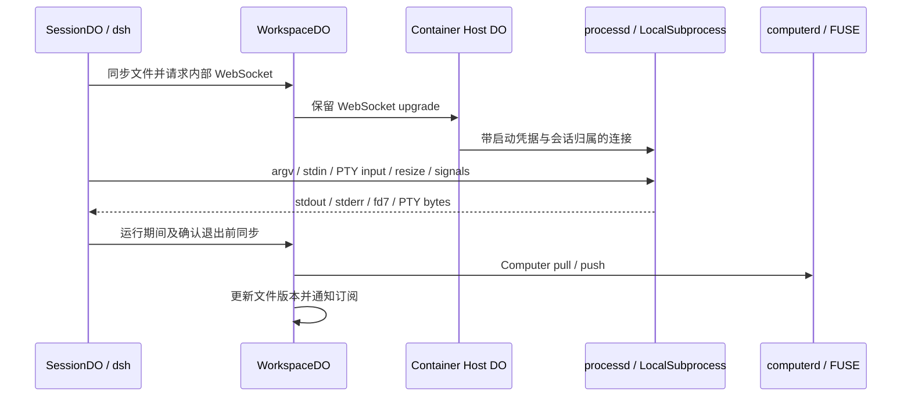

# 容器真实进程与 PTY

`workspace-runtime` 选择容器后，Harness 的 subprocess 与终端接到容器内的 `processd`。它复用固定版本 dsh 的 `LocalSubprocessRuntime`、`node-pty` 和 `sandbox-local`；Worker shell 仍使用 just-bash 与行终端。官方工具、终端控制器和 UI 契约保持不变。

## 行为

- 普通进程支持独立二进制 stdout、stderr，连续 stdin、EOF 与双向 fd7。输入每次最多 64 KiB，适配层拆分普通大输入；PTY 接受 UTF-8 文本，每次最多 64 KiB。
- PTY 是持续存活的 Linux shell：变量、cwd、任务控制和交互式 Python 使用同一进程；支持 resize、前台进程组检查与信号。终止终端或处置会话时清理其拥有的进程。
- 每条连接由容器启动凭据鉴权，句柄以根 Session ID 分域。不同会话可共享环境文件与容器，但不能操作彼此的进程句柄。环境容器本身仍是共享执行边界，并非每条命令独立容器。
- 输出以绝对字节位置读取，有限缓存支持同一服务实例内的连接重建。每通道缓存达到 128 KiB 后暂停原版流，向子进程传递背压。终止时恢复读取以避免清理死锁，超出缓存的后续终止输出会被丢弃。
- 启动 ID 与输入序号提供重试去重；容器 generation 改变时旧客户端失败，不自动重放命令。后续新执行可建立新客户端。浏览器在原 SessionDO 仍存活时可重新附着官方终端；没有实现跨 SessionDO 重建或容器重启的 PTY 恢复。
- 进程启动前合并文件；运行期间约每秒及确认退出前进行 pull/push，更新 Weft 版本，拒绝基于旧版本的编辑。同步失败会明确失败，不宣称文件已持久化。它不提供进程每次 write 与 DO 之间的同步事务；突然重启仍可能丢失尚未同步的文件变化。

## 沙箱与生命周期

容器内由原版 `sandbox-local` 探测并选择 bubblewrap 或 Landlock。`read-only` 与 `workspace-write` 实际约束进程文件效果；没有可用 runner 时拒绝启动，runner 故障与正常命令拒绝分别报告。旧 Landlock ABI 可能返回 `partial`，适配层保留该事实。`danger-full-access` 仍受工作区容器边界约束。

容器使用 tini 管理两个 daemon；任意一个退出都会终止容器。普通进程、PTY 的子树清理由原版 dsh 管理。在没有可用 user-systemd 的 Linux 容器中使用原版 PGID/进程树回退，不能保证捕获主动逃离该范围的进程。运行中的普通任务及无法证明空闲的 PTY 保持容器活动；具有明确空闲证据且 10 分钟无输入的 PTY 会被清理，容器随后可进入已有的空闲休眠流程。

资源上限为每容器 32 个未静止进程、每会话 16 个；最多保留 256 条进程记录，结束且静止的记录在 60 秒未读取后回收。启动回执最多 8192 条，达到上限需重启容器，避免无限增长并防止旧启动 ID 再执行。源码、`.git`、依赖缓存与单文件容量策略沿用 [Git 项目与容器工作区](workspace-git.md)。

## 构建与验证

镜像构建输入包括 Dockerfile、启动脚本、服务源码、容器依赖锁、根依赖锁、上游固定版本和服务打包脚本。原生依赖仅安装在容器中，不进入 workerd。`node scripts/workspace-container.mjs --local` 构建本地镜像；`WEFT_LOCAL_CONTAINER=1 npm run build` 验证本地镜像与源码一致。普通构建继续要求已记录的仓库镜像与输入一致。

- `npx tsx --test tests/process-client.test.ts`：响应丢失后的安全重试、应用错误不重连、generation 改变后拒绝重放。
- `WEFT_CONTAINER_IMAGE=<本地镜像> npm run test:process:container`：真实 Docker/FUSE、PTY Python 输入、状态保留、resize、Ctrl-C、重连、二进制通道、2 MiB stdin、fd7、内核文件限制、子树终止、输出阻塞时清理，以及 Worker 适配层和真实 computerd 文件同步/版本冲突。
- 既有 `native-terminal`、`native-persistent-shell`、`native-shell`、`native-workspace-runtime`、`native-workspace-changes` 与浏览器终端/运行环境测试继续覆盖 Worker 和官方 UI。

真实容器测试默认跳过；跳过不算容器验证通过。本轮不部署 Worker 或 Container 应用，云端宿主的完整端到端验收仍需部署后执行。

`ci` 分支的 GitHub Actions 在构建阶段执行严格类型检查，并以独立的 Container processes and FUSE 任务在 runner 上构建镜像、启用真实进程和 Git/FUSE 用例；单元与浏览器测试沿用现有分片任务。
